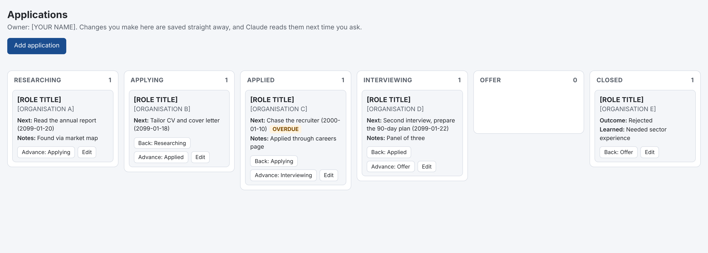

# Career Helper

End-to-end career support with guided coaching for job seekers at all levels, plus AI governance guidance for Non-Executive Directors and Board Governors, built for Claude Cowork. Seventeen skills, including Tim (your personal career coach who guides you through the right skills in the right order), CV and application work, interview preparation, job search planning, market mapping, personal brand, career transitions, and board-level AI oversight.

Your work lives where you can use it: an interactive application board and market map that you and Claude both keep up to date, an ikigai map you can edit, progress and footprint dashboards, Claude Docs you can annotate, print, and export to Word or PDF, and slide decks for interview presentations and board briefings. Ready-made Cowork scheduled routines keep the search moving between sessions.

**Created by:** Prosper AI Consulting | [GitHub](https://github.com/Zal4DW/career-helper) | [Issues](https://github.com/Zal4DW/career-helper/issues) | [Privacy statement](PRIVACY.md)

---

## Installation

Career Helper runs in Claude Cowork, in the Claude desktop app.

If Career Helper is listed in the Claude plugin directory, install it from there. Otherwise, add it from GitHub:

1. Click the **+** button next to the chat input
2. Select **Add plugins...**
3. In the Browse plugins dialog, open the filter dropdown and choose **Add marketplace from GitHub**
4. Enter `Zal4DW/career-helper` and click **Sync**
5. Click **Install** on the Career Helper plugin

The skills and commands are ready to use straight away. Scheduled routines need a paid Claude plan; check Claude's help centre for which artifact, Docs, and Slides features your plan includes.

---

## Getting Started

Not sure where to begin? Try one of these:

```
/career-helper:career-coach        Guided coaching with Tim - recommended for new users
/getting-started                   Full overview of everything available
/career-helper:quick-start         Guided questions to route you to the right skill
/career-helper:help                Skill navigator - describe your situation
```

Or just describe what you need. Example prompts:

```
"I want to apply for a Senior PM role at Google"
"Help me prepare for an interview next Tuesday"
"I got an offer - should I negotiate?"
"I want to go fractional"
"I'm thinking about starting my own business"
"What are my options besides climbing the corporate ladder?"
"Check my digital footprint before I apply"
"Review my social media - I'm a graduate about to start applying"
"Show me my applications as a board"
"Map the companies like mine that are hiring, and keep an eye on them weekly"
"I have to present a 90-day plan at my second interview; help me build the slides"
```

---

## Skills

| Skill | What It Does | Command |
|:------|:-------------|:--------|
| **Getting Started** | Full overview, preparation checklists, workflow planning, skill tips, power user strategies | `/getting-started` |
| **Career Routines** | Claude Cowork scheduled tasks for the one-command weekly update and narrower routines: tailored prompts, honest cloud-or-local guidance, a register of what is running, and troubleshooting | `/career-routines` |
| **Career Outputs** | Publishes and finds your application board, market map, ikigai map, progress and footprint dashboards, Claude Docs, and slide decks, and keeps a register of their links | `/career-outputs` |
| **Employer Footprint** | Digital footprint audit through employer's eyes, social media scan, credit-report style report and interactive dashboard, interview questions from online presence | `/employer-footprint` |
| **Social Media Review** | Quick social media check through recruiter's eyes, privacy cleanup guide. Especially useful for graduates and early career. | `/social-media-review` |
| **Application Optimiser** | Company and role research, ATS-optimised CV rewriting, cover letters and supporting statements, application strategy, verified CV PDF production with layout and ATS text-layer checks | `/application-optimiser` |
| **LinkedIn Coach** | Profile audit, headline optimisation, content strategy, post review, video scripts | `/linkedin-coach` |
| **Interview Master** | Interview prep built from a competency map (Strong, Partial, Gap ratings, top five risks, four-step objection handling, timed openers, one-page dashboard), mock interviews, interviewer perspective reports, post-interview coaching, reference and referee prep, interview presentation slides, ageism support (UK law, practical strategies, emotional resilience) | `/interview-master` |
| **Career Navigator** | Networking intelligence, 3-month job search plans, salary negotiation, offer evaluation, and an application tracker on an interactive board you and Claude both update | `/career-navigator` |
| **Job Scout** | Live role discovery across boards and careers pages with honest coverage caveats, batch ranking of postings with deal-breaker vetting and deadline flags, shortlist feeding your application board | `/job-scout` |
| **Skills Radar** | Evidenced skills inventory (including your public work, with consent), gap analysis against a target role, realistic learning plans | `/skills-radar` |
| **Market Mapper** | Evidenced map of ten to fifteen organisations like your employer with dated hiring, growth, investment, and change signals, decision makers confirmed by public sources, discreet angles for the employed, a weekly update that reports only what changed, all kept on an interactive market map board | `/market-mapper` |
| **Career Transitions** | Portfolio and fractional careers, AI readiness assessment, non-linear career exploration (entrepreneurship, startups, public sector, charity, intrapreneurship, multi-role skilling) | `/career-transitions` |
| **AI Impact Assessment** | Researches whether AI will materially disrupt your role in the next 12 months, with a 6-month mitigation plan | `/ai-impact-assessment` |
| **NED AI Helper** | AI governance for Non-Executive Directors, Board Governors, and Charity Trustees. Challenge frameworks, risk assessment, governance structures, regulatory guidance, board papers as Claude Docs, and board briefing slides | `/ned-ai-helper` |
| **Personal Brand** | Why You, Why Them, Why Now positioning; audience and channel map; content pillars; bio library across LinkedIn, X, speaker bio, podcast bio, About page, and board bio. Persona guides for NEDs, fractional, and career returners | `/personal-brand` |
| **Career Coach (Tim)** | Guided career coaching, understands your situation, reads emotional signals, runs the right skills in the right order, checks in after difficult work, with accessibility support and persistent agent memory | `/career-helper:career-coach` |

## Commands

| Command | Purpose |
|:--------|:--------|
| `/career-helper:help` | Find the right skill for your situation |
| `/career-helper:quick-start` | Guided entry point - answers questions and routes you |
| `/career-helper:status` | Check your progress, see generated outputs, and refresh your progress dashboard |
| `/career-helper:weekly-update` | Run every recurring update in one unattended pass and save a dated report; built to go on a schedule |
| `/career-helper:career-coach` | Start a guided coaching session with Tim |

---

## Typical Workflow

**Prefer guided support?** Run `/career-helper:career-coach` and Tim will handle the sequencing for you, checking in between each step.

**Or run skills yourself:**

```
0. Audit your digital footprint   /employer-footprint
1. Research the company           /application-optimiser
2. Optimise your CV               /application-optimiser
3. Write your cover letter        /application-optimiser
4. Sync your LinkedIn             /linkedin-coach
5. Track every application        /career-navigator
6. Prepare for interviews         /interview-master
7. Practice with mock interview   /interview-master
8. Prepare your references        /interview-master
9. Negotiate your offer           /career-navigator
10. Evaluate competing offers     /career-navigator
```

**Tip:** In Claude Cowork, put `/career-helper:weekly-update` on a weekly `/schedule` and the application board standup, follow-up check, market map update, and progress dashboard refresh run without you. `/career-routines` sets it up and explains when a task runs in the cloud and when it needs your computer.

---

## Features

- **Built for Claude Cowork** with interactive boards, dashboards, Claude Docs, and slide decks in your own Claude account
- **UK English** throughout (adapts to US when the role requires)
- **Region-aware** guidance for UK, US, EU, and APAC markets
- **Research-driven** with cited sources and access dates
- **ATS-optimised** CV output with keyword coverage analysis
- **Cover letters and supporting statements** with the same anti-hallucination guardrails as CV work
- **Application board** every live application as a card in six stage columns (Researching to Closed), private to you in your Claude account. Drag applications between stages and edit next actions; Claude reads your changes back in any later session, including a scheduled weekly update. No export step.

  
  *The application board, shown with placeholder data.*
- **Claude Docs and slides** interview packs, board papers, plans, and brand work as Claude Docs you can annotate, print, and export to Word or PDF; interview presentations and board AI briefings as slide decks
- **Dashboards** a progress dashboard (pipeline, overdue actions, weekly trend, market map) refreshed by the weekly update, and an employer footprint dashboard; every number shows its source
- **Job scouting** live role discovery and five-dimension batch ranking, honest about the limits of automated job-board search (and able to use a signed-in browser, Cowork's built-in browser or the Claude in Chrome extension, for logged-in boards)
- **Skills radar** an evidenced skills inventory that separates real skill gaps from evidence gaps, with learning plans built around your actual weekly hours
- **Market mapper** a map of organisations like your employer with dated signals and named decision makers, built for the employed and discreet, with a weekly update that reports only what changed, all kept on a market map board (four priority columns, same mechanics as the application board) where you can reprioritise and see every signal's source
- **Verified CV PDFs** a generate-verify loop that renders an ATS-safe PDF, checks the text layer parses, and inspects the layout page by page
- **Reference and referee prep** choosing, asking, and briefing referees, with UK conventions and regulated-role notes
- **Weekly update on a schedule** one command (`/career-helper:weekly-update`) runs the application board standup, follow-ups, market map update, learnings check, and progress dashboard refresh unattended and saves a dated report; the career routines skill puts it on a Claude Cowork `/schedule` and keeps a register of what is running
- **Ikigai direction-finding** Tim's four-question exercise for when you do not know what you want, with an optional interactive, colour-blind-safe ikigai map you can keep and edit
- **Career stage adaptation** from graduates to late career
- **Wellbeing-aware coaching** Tim reads emotional signals, acknowledges difficulty before routing, checks in after heavy work, and carries wellbeing context across sessions
- **Ageism support** UK law, practical strategies, and emotional resilience for age-related rejection
- **Template-driven** consistent, professional outputs
- **Digital footprint audit** credit-report style employer impression report and dashboard
- **Non-linear career exploration** entrepreneurship, startups, public sector, charity, intrapreneurship, and multi-role skilling with honest pros/cons and decision frameworks
- **Guided coaching** Tim orchestrates skills based on your situation with structured checkpoints and persistent agent memory that improves routing over time
- **Accessibility across all skills** dyslexia-friendly enhanced mode with signposting, numbered options, and plain language; colour-blind safe output with text labels instead of colour coding. Preferences stored in `career-helper-preferences.md` and respected by every skill, command, and Tim

---

## Output Files

### In your Claude account

| Output | Kind | Generated By |
|:-------|:-----|:-------------|
| Career Helper Applications | Interactive board (the application record) | Career Navigator |
| Career Helper Market Map | Interactive board (the market map record) | Market Mapper |
| Career Helper Ikigai | Interactive map | Tim (Career Coach) |
| Career Helper Progress | Dashboard | Status and Weekly Update commands |
| Career Helper Footprint | Dashboard | Employer Footprint |
| Interview packs, debriefs, referee briefings | Claude Docs | Interview Master |
| Interview presentations | Slide decks | Interview Master |
| Board AI papers and briefings | Claude Docs and slide decks | NED AI Helper |
| Plans, evaluations, brand work, learning plans, AI impact assessments | Claude Docs (offered) | The owning skill |

Everything above is private to you unless you share it from its share menu. `career-helper-artefacts.md` in your workspace lists each one with its link.

### In your workspace folder

| Output | Generated By |
|:-------|:-------------|
| `applications/{role-slug}/research-brief.md` | Application Optimiser |
| `applications/{role-slug}/cv-optimised.md` | Application Optimiser |
| `applications/{role-slug}/cover-letter.md` | Application Optimiser |
| `applications/{role-slug}/supporting-statement.md` | Application Optimiser |
| `applications/{role-slug}/application-strategy.md` | Application Optimiser |
| `applications/{role-slug}/cv.pdf` and `cover-letter.pdf` | Application Optimiser |
| `applications/{role-slug}/linkedin-profile-review.md`, `content-strategy.md`, `content-calendar.md` | LinkedIn Coach |
| `applications/{role-slug}/interview-prep.md`, `interviewer-perspective.md`, `post-interview-debrief.md`, `referee-prep.md` | Interview Master |
| `applications/{role-slug}/networking-intelligence.md`, `negotiation-strategy.md` | Career Navigator |
| `three-month-plan.md`, `offer-evaluation.md` | Career Navigator |
| `applications/tracker.md` (read-only snapshot of the application board) | Career Navigator |
| `applications/learnings/` | Career Navigator |
| `portfolio-career-strategy.md`, `ai-readiness-plan.md`, `non-linear-career-exploration.md` | Career Transitions |
| `{role}-ai-impact-assessment.md` | AI Impact Assessment |
| `{topic}-challenge-questions.md`, `-risk-register-entry.md`, `-governance-options.md`, `-change-readiness-report.md`, `-hitl-assessment.md` | NED AI Helper |
| `{name}-footprint-dashboard.md`, `{name}-{company}-employer-impression.md`, `{name}-social-media-audit.md`, `{name}-footprint-interview-questions.md` | Employer Footprint |
| `{name}-social-media-review.md`, `{name}-social-cleanup-guide.md` | Social Media Review |
| `personal-brand-*.md` | Personal Brand |
| `applications/shortlist.md` | Job Scout |
| `skills-inventory.md`, `skills-gap-analysis.md`, `learning-plan.md` | Skills Radar |
| `market-map.md` (read-only snapshot of the market map board), `market-watch/{date}-update.md` | Market Mapper |
| `updates/{date}-weekly-update.md` | Weekly Update command |
| `routines.md` | Career Routines |
| `career-helper-artefacts.md` | Career Outputs |
| `career-helper-preferences.md` | Tim (Career Coach) |

---

## Workspace Tip

Use Desktop Cowork and select the same local folder for your career-helper sessions, so each skill can build on earlier work. Your boards, dashboards, Docs, and slides live in your Claude account, so they are there whichever folder you use; your CVs, research briefs, and reports live in the folder.

---

## Data Handling

Career Helper is an open source plugin that runs entirely inside your Claude account. Prosper AI Consulting receives no data, runs no servers, and collects no analytics or telemetry. We do not know who has installed the plugin. Everything it produces is saved in your own workspace or your own Claude account and belongs to you. See the [privacy statement](PRIVACY.md).

What the plugin runs, fetches, and stores:

- **Files** in the workspace folder you choose: CVs, plans, reports, and snapshots.
- **Artifacts, Claude Docs, and slide decks** in your Claude account, published only when a skill offers one and you agree. They are private to you unless you share them. The boards keep their data in the artifact's own database, which only you (and anyone you share with) can see.
- **Web research** through Claude's own search and fetch tools, for public information such as company news, job listings, and regulation.
- **A signed-in browser** (Cowork's built-in browser or Claude in Chrome), only when you ask it to search a site you are signed in to, such as LinkedIn.
- **Two Python packages**, `markdown` and `weasyprint`, installed in your Cowork environment when you ask for a verified CV PDF; the scripts are in `skills/application-optimiser/scripts/`.

The plugin has no hooks, no MCP servers, and no executables, and sends nothing to any service of its own.

---

## Troubleshooting

| Problem | What to do |
|:--------|:-----------|
| A skill cannot find your earlier work | Select the same workspace folder you used before; boards and Docs are in your Claude account and are found by title |
| "No application board found" | Ask "help me track my applications" to build it; keep the title `Career Helper Applications` |
| The board says it cannot load your data | Open it from Claude while signed in; boards keep their data in Claude, so they do not work as a saved file |
| A scheduled weekly update did not run | Run `/career-routines` and ask why; the usual cause is a task given a local folder while the computer was asleep |
| The CV PDF step fails to install packages | Ask Claude to export the CV from a Claude Doc instead, then run the verifier on the result (see the CV PDF guide) |
| LinkedIn or Indeed results are thin | Offer Claude a signed-in browser for those sites; the skills say which sources they could not reach |

---

## Changelog

See [CHANGELOG.md](CHANGELOG.md) for the full version history.

---

## Contributing

Found a bug, have a suggestion, or want to improve something? We welcome contributions and feedback.

- **Report issues** - [Open an issue](https://github.com/Zal4DW/career-helper/issues) for bugs, feature requests, or suggestions
- **Start a discussion** - [Join discussions](https://github.com/Zal4DW/career-helper/discussions) to share your experience or ask questions
- **Share your success** - Landed a role using Career Helper? We'd love to hear about it
- **Spread the word** - Tell others who might benefit from this plugin

---

## License

Creative Commons Attribution-NonCommercial 4.0 International (CC BY-NC 4.0)

See [LICENSE](LICENSE) for full terms.

---

*Career Helper Plugin | Prosper AI Consulting, UK*
